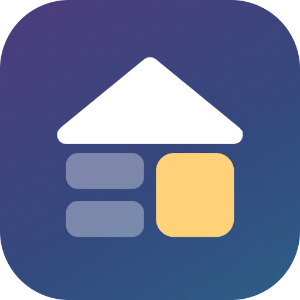

<p align="center"></p>

# Terral Home

**Dashboard, Theme, Cards & Notifications for Home Assistant**

*Nexa Projects by Manuel Escaño*

[](https://hacs.xyz/docs/faq/custom_repositories)
[](https://github.com/nexaproject-repository/terral-home/actions/workflows/validate.yml)
[](LICENSE)

> 🚧 Early development (v0.14.0). It works day to day, but things still change between versions.

Terral Home gives Home Assistant a clean, glass-style home screen inspired by modern mobile home apps: a full-screen page of its own, cards you add and arrange by touch, and windows for every device. A notification system that knows whether you are home, away or asleep is planned.

- [What you get today](#what-you-get-today)
- [Installation](#installation-hacs)
- [Using Terral Home](#using-terral-home)
- [Cards](#cards)
- [Using the cards in other dashboards](#using-the-cards-in-other-dashboards)
- [Privacy](#privacy)
- [Roadmap](#roadmap)
- [Development](#development)
- [Español](#español)

## What you get today

- **Several dashboards**, each its own entry in Home Assistant's sidebar (name and icon of your choice), so each device can open its own one.
- **Terral Home page** in the sidebar: full screen, no Home Assistant toolbar, with the "crepúsculo" background and the phone's status and home bars blended in.
- **Same card size on every screen**: columns are about as wide as on a phone, every section is 2 columns wide, and tablets and computers place more sections side by side (each in the shortest column) instead of stretching the cards. Card sizes (height/width): **1/1, 2/1, 2/2 and 4/2**.
- **Add cards by type** (light, alarm, EV charger, climate, weather, robot vacuum), then choose the device and name.
- **Arrange by touch**: long-press a card to move it, drag the bottom-right corner to resize, remove with **−**.
- **Pages** inside a dashboard, chosen with pills under the title, each with its own favourites and sections.
- **Main dashboard per user**: open it at sign-in, and optionally show only that dashboard in the user's sidebar.
- **Favourites strip** on tablets and computers: the cards without a section run across every column on top, 1 row of 1/1 cards or 2 rows mixing 1/1, 2/1 and 2/2; swipe sideways when they don't fit.
- **Sections** with titles; move a whole section at once, or create one per Home Assistant area.
- **Quick actions** on the right of each section title: turn every light of the section on or off (and, if you enable it, every climate device).
- **A window for every card** with all its controls, and a **gear** for the card settings.
- **One shared layout** for the whole household, stored by the integration.
- Spanish and English.

## Installation (HACS)

Requires Home Assistant **2026.3** or newer.

1. HACS → ⋮ → **Custom repositories**.
2. Add `https://github.com/nexaproject-repository/terral-home` as **Integration**.
3. Install **Terral Home** and **restart Home Assistant**.
4. **Settings → Devices & services → Add integration → Terral Home**.

**Terral Home** then appears in the sidebar.

To update: HACS → Terral Home → **Redownload**, restart Home Assistant, then fully close and reopen the Companion app (it caches the page).

## Using Terral Home

| Action | How |
| --- | --- |
| Add a card | **+** (top right) → pick the type → pick the device (or the alarm / weather) and the name → **Add** |
| Open a card's window | Tap the card |
| Quick action | Tap the card's icon (switch a light, lock the charger, turn the climate on or off, pause the robot or pick one of its routines…) |
| Card settings | Gear in the card's window → **Save**, or **Remove card** |
| Move mode | Long-press any card. In move mode, swipe to scroll; rest a finger on a card for a moment to pick it up |
| Resize | In move mode, drag the arc at the bottom-right corner |
| Remove | In move mode, **−** on the card |
| Sections | In move mode: **Add section**, tap a title to rename it, drag its three lines to move the block, **−** removes it (you choose whether its cards stay) |
| Section quick actions | Round buttons on the right of a section title. Lights: amber with how many are on; a tap turns them all off, or all on when every light is off. In move mode, the gear on the title opens the section settings: name, which quick actions show (lights, climate) and **Remove section** |
| Dashboard settings | **···** → **Dashboard settings**: name and icon in the sidebar, admins only, favourites strip (on/off, 1 or 2 rows), **Delete dashboard** (not the first one) |
| New dashboard | **···** → **New dashboard** (admins): name and icon; it appears in the sidebar at once with an empty page |
| Pages | In move mode: **+ Página** adds a page; tap the active pill (gear) to rename it, move it before/after or delete it (its cards go to the first page or away). Drop a card on a pill to move it to that page. Every page has its own address (`/terral-home/<page>`) |
| Main dashboard of a user | Sign in as that user → open the dashboard → **···** → **Dashboard settings** → **Use as my main dashboard** (and, if wanted, **Only this dashboard in my sidebar**). Admins can also make it the main one for the whole house. Mark the other dashboards **Admins only** so non-admin users can't open them |
| Sections per room | **···** → **Create sections by room** |
| Finish | **Done** |

## Cards

All cards share the same look: an icon circle, name and status, and a tinted background when the device is active. Their settings are opened from the gear in the window.

### Light

For a light or a Home Assistant light group.

- **Sizes**: 1/1, 2/1, 2/2 and 4/2 (4/2 for colour, temperature and group lights).
- **Icon** switches it on or off; the card tints with the light's real colour.
- **Window**: brightness, temperature, colours and, for groups, each member.
- **Settings**: device (light groups listed apart), which light of the device, tint with the light colour.

### Alarm

For [Alarmo](https://github.com/nielsfaber/alarmo) or any alarm panel. 2/2.

- One button per enabled mode (away, home, vacation). While arming, an amber ring empties and the seconds blink; once armed only **Disarm** shows.
- A code pad when the alarm needs a code; **Arm anyway** when Alarmo finds something open.
- Entry delay counts down in red; a triggered alarm flashes.
- **Window**: every mode (night and custom too), skip the delay, open and bypassed sensors.
- **Settings**: name only (the alarm is picked automatically; a picker shows if there is more than one). The type is greyed out with "Alarmo is not installed" when there is no alarm.

### EV charger

Lock and unlock the charger and follow the charge.

- **Sizes**: 1/1, 2/1, 2/2 and 4/2 (4/2 adds the last-hour power chart).
- **Colours**: green while charging; warm cream with an orange icon and a dark red lock when the car is plugged in but the charger is locked; sky blue when ready; glass with a grey lock when locked without a car.
- **Window**: last 7 days and recent charges (from the power sensor's history).
- **Settings**: charger device, the switch / lock / `input_boolean` that blocks charging, **Invert** (with an explanation of what on and off mean), status / power / energy sensors (detected on the same device), maximum power.

### Climate

For any climate entity: air conditioning (split or ducted), heating, heat pump.

- **Sizes**: 1/1, 2/1, 2/2 and 4/2.
- **Icon** turns it on and off (back to the last mode); "off" is never listed as a mode.
- **2/2**: mode · − temperature + · fan speed. **4/2**: a large draggable dial, mode bottom-left, fan bottom-right.
- Temperature and fan dim in the modes that don't use them; the mode button is hidden when the unit has a single mode.
- **Window**: temperature, modes, fan speed (with the reason when it is fixed), swing (only if enabled in the settings), presets.
- **Settings**: device and name, minimum / maximum temperature and steps (0.5° or 1°), what to show in each mode, show swing.

### Weather ("Cielo")

For Met.no or any weather entity.

- **Sizes**: 1/1, 2/1, 2/2 and 4/2.
- The card is the sky: a gradient that follows the weather and the time of day (sun below the horizon), with falling rain or snow.
- **2/2**: next 6 hours (or days). **4/2**: next hours and 3 days with min–max bars.
- **Window**: humidity, wind and direction, pressure, clouds, dew point, rain today, 24 hours and 5 or 7 days.
- **Settings**: name, hours or days on 2/2, rain/snow animation, current details, forecast days.

### Robot vacuum

For a robot that vacuums and/or mops. Made for [Roborock](https://www.home-assistant.io/integrations/roborock/), works with any vacuum entity (what the robot doesn't report is simply not shown).

- **Sizes**: 1/1, 2/1 and 2/2. The icon is a round floor robot.
- **Waiting** (docked or idle, glass card): 2/2 shows your **3 main routines** as buttons; the robot icon opens **every routine** (also on 1/1 and 2/1).
- **Cleaning** (teal): the icon pauses; 2/2 shows progress, area and time, pause and back to the dock. **Going home**: sky blue.
- **Stuck / error** (red): the icon stays the same with a red **!** at its bottom-right; 2/2 offers resume, back to the dock and locate.
- **Battery** in the text, with a small battery icon that empties by steps and turns amber below 40 % and red below 20 % (a bolt while charging on the dock).
- **Window**: what to do (vacuum, mop or both), suction, water, mop mode, where (whole home or rooms), start / pause / dock / locate and every routine. Controls that do nothing right now are dimmed, with the reason: water and mop mode only when mopping, suction off when only mopping, pause only while running, "to the dock" not when it's already there.
- **Settings**: device and name, and the routines on the card (pick up to 3, numbered in the order you pick them; scripts that look like robot scripts can be added too).

How it reads Roborock: battery, progress, area, time, current room and error come from the sensors on the robot's device; water and mop mode are its `select` entities; Roborock has no "mode" entity, so *mop only* is suction `off` and *vacuum only* is water `off`; each routine of the Roborock app is a `button` on the device; rooms come from the `roborock.get_maps` action and a room clean is sent as `app_segment_clean`.

## Using the cards in other dashboards

The cards are also registered for normal Lovelace dashboards. Settings made in the gear are saved only inside the Terral Home page; in other dashboards use YAML.

```yaml
type: custom:terral-home-light
entity: light.living_room
name: Living room           # optional
use_light_color: true       # tint with the light colour
group_by_area: auto         # auto | always | never (group window)
```

```yaml
type: custom:terral-home-alarm
entity: alarm_control_panel.alarmo
name: Alarm                 # optional
```

```yaml
type: custom:terral-home-charger
entity: switch.charger_lock # switch, lock or input_boolean
invert: true                # on = locked
status_entity: sensor.charger_status   # optional, "none" to hide
power_entity: sensor.charger_power     # optional
energy_entity: sensor.charger_energy   # optional
max_power: 7.4                         # kW, optional
```

```yaml
type: custom:terral-home-climate
entity: climate.air_conditioning
min_temp: 17                # optional, within the unit's limits
max_temp: 28
temp_step: 0.5              # 0.5 or 1
show_swing: false
mode_rules:                 # optional: what each mode shows
  dry: { t: false, f: false }   # t = temperature, f = fan speed
```

```yaml
type: custom:terral-home-weather
entity: weather.home
forecast_2x2: hourly        # hourly | daily
animate: true
show_details: true
forecast_days: 7            # 5 | 7
```

```yaml
type: custom:terral-home-vacuum
entity: vacuum.roborock
routines:                   # optional: the 3 buttons on the 2/2 card, in order
  - button.roborock_daily   # a Roborock routine button…
  - script.vacuum_kitchen   # …or a script
```

## Privacy

Everything stays in your Home Assistant. The layout is saved in Home Assistant's storage (`.storage/terral_home.layout`); the cards only read entity states and history and call Home Assistant services. Terral Home sends nothing to outside services.

## Roadmap

- Own navigation menu (phone button, compact sidebar on tablets).
- Terral Home settings: general colour palette, 10 backgrounds, theme.
- More cards: covers, sensors, scenes, cameras, appliances.
- Robot vacuum: live map of the cleaning.
- Notifications routed by house state (asleep → silent push, at home → Alexa and/or phone, away → phone; critical alerts always through) and appliance detectors (dishwasher, washing machine, oven…).
- Collapsible sections.

## Development

See **[docs/architecture.md](docs/architecture.md)** for how the integration and the frontend fit together, the websocket API, the layout format, the card contract and the release steps. Changes per version are in **[CHANGELOG.md](CHANGELOG.md)**.

Quick start:

```bash
cd frontend
npm install
npm run build      # type-checks and writes custom_components/terral_home/www/terral-home.js
```

---

## Español

Terral Home da a Home Assistant una pantalla de inicio limpia, con efecto cristal, inspirada en las apps de casa de los móviles: una página propia a pantalla completa, tarjetas que añades y colocas con el dedo y una ventana para cada dispositivo.

- **Instalación**: en HACS añade este repositorio como **repositorio personalizado** de tipo **Integración**, instala **Terral Home**, reinicia y añade la integración desde **Ajustes → Dispositivos y servicios**. Aparecerá **Terral Home** en la barra lateral.
- **Añadir una tarjeta**: **+** → tipo de tarjeta (luz, alarma, cargador, clima, tiempo, robot aspirador) → dispositivo y nombre → **Añadir**.
- **Robot aspirador** (Roborock u otros): en espera, la 2/2 muestra tus 3 rutinas principales (se eligen en los ajustes) y el icono abre todas; limpiando, el icono pausa y se ve el progreso; atascado, sale una **!** roja sobre el icono. La batería va en el texto. En la ventana: aspirar / fregar / ambos, potencia, agua, modo de mopa, habitaciones y rutinas; lo que no aplica se apaga.
- **Ordenar**: pulsación larga en una tarjeta para entrar en modo mover; desliza para desplazarte y deja el dedo quieto un instante sobre una tarjeta para agarrarla. La esquina inferior derecha cambia el tamaño y **−** la quita.
- **Mismo tamaño en móvil, tablet y PC**: cada apartado ocupa 2 columnas y en pantallas anchas se ponen varios apartados uno al lado de otro (cada uno en la columna más corta).
- **Accesos rápidos** a la derecha del título de cada apartado: encienden o apagan todas sus luces (y, si lo activas, el clima). Se configuran con el engranaje del apartado en modo mover.
- **Varios dashboards**: **···** → **Nuevo dashboard**. Cada uno es una entrada propia del menú de Home Assistant, con su nombre e icono, para ponerlo como principal en cada dispositivo. Sus ajustes (nombre, icono, favoritos) están en **···** → **Ajustes del dashboard**.
- **Favoritos** en tablet y PC: las tarjetas sin apartado van arriba, a todo el ancho, en 1 fila (tarjetas 1/1) o 2 filas (1/1, 2/1 y 2/2); si no caben, se deslizan.
- **Páginas** dentro de un dashboard: píldoras bajo el título. En modo mover, **+ Página** crea una; la píldora activa (engranaje) la renombra, la mueve o la elimina. Arrastra una tarjeta a una píldora para pasarla a esa página.
- **Un dashboard para cada persona** (por ejemplo, Natalia, que no es administradora): crea su dashboard y marca los demás como **Solo administradores**. Después, entrando con el usuario de Natalia, abre su dashboard → **···** → **Ajustes del dashboard** → **Usar como mi dashboard principal** y **Solo este dashboard en mi menú**. Al entrar verá solo el suyo.
- **Apartados**: en modo mover, **Añadir apartado**; toca el título para renombrarlo y arrastra las tres líneas para moverlo entero. También puedes crearlos por habitación desde **···**.
- **Ajustes de cada tarjeta**: engranaje en su ventana.
- **Actualizar**: HACS → **Volver a descargar**, reiniciar Home Assistant y cerrar y abrir la app.

## License

[MIT](LICENSE) © 2026 Manuel Escaño (Nexa Projects)
